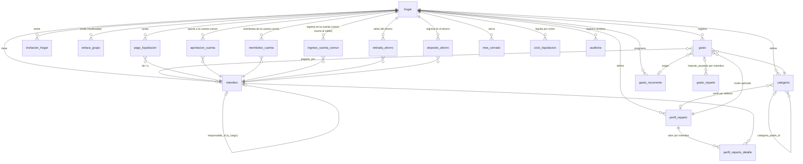

# Modelo de datos

PostgreSQL (Supabase). **La fuente de verdad es `supabase/migrations/*.sql`**; este documento es un mapa para orientarse. EF Core solo mapea (`MiParteDbContext`). Todas las tablas cuelgan de `hogar` (`hogar_id`) con RLS y filtro global por hogar en el servicio.

**Escritura solo por Core.Api** (migración `20261011000000_cerrar_escritura_directa.sql`): `anon` y `authenticated` solo conservan `SELECT` (acotado por RLS; `anon` ni eso) y no pueden insertar, actualizar ni borrar, porque la anon key es pública y permitiría saltarse las validaciones de la API vía PostgREST. Las RPC `crear_hogar` y `aceptar_invitacion` ya no son ejecutables por `authenticated` (Core.Api las replica con sus topes). Las tablas llevan además `check` de longitud (nombres ≤ 100, conceptos ≤ 200). El rol de conexión de Core.Api debe ser propietario (`postgres`), nunca `authenticated`.

## Tablas

| Tabla | Contenido y reglas |
|---|---|
| `hogar` | Nombre, `cuenta_comun_activa` y `ahorro_activo` (false por defecto; los activa un admin desde la configuración del hogar; Core.Api bloquea las escrituras de la cuenta común mientras la primera esté a false, y las del ahorro —parte de ahorro de las aportaciones, depósitos, retiradas y gastos pagados desde el ahorro— mientras lo esté la segunda; migración `20261024120000_ahorro_activo.sql`). `recurrentes_activas` (true por defecto: los hogares existentes quedan activados; lo activa un admin desde la configuración del hogar; con false, Core.Api no crea plantillas ni genera gastos recurrentes y las plantillas quedan pausadas sin borrarse; `Scripts/20261021120000_hogar_recurrentes_activas.sql`, y la columna va también en `Estructura/01_Tablas/hogar.sql`). Al crearlo (`crear_hogar`) se siembran 4 perfiles y 6 categorías y el creador entra como admin y adulto. El saldo inicial de la cuenta para gastos va en `saldo_inicial_fecha` y `saldo_inicial_importe` (`numeric(12,2)`, `importe >= 0`; las dos columnas van juntas o ninguna, `hogar_saldo_inicial_check`); se añaden con `Estructura/01_Tablas/hogar.sql`, sin script de migración. `tipo` (texto, no nulo, `'hogar'` por defecto; `hogar_tipo_check`: `hogar`, `piso_compartido`, `viaje`, `evento` u `otro`) es el tipo de grupo; lo fija `POST /api/hogares` (sin valor, `hogar`) y no cambia después. `periodo_desde` y `periodo_hasta` (`date`, ambos opcionales; `hogar_periodo_check`: o los dos nulos —el hogar usa meses—, o `periodo_desde` informado y `periodo_hasta` nulo —abierto— o igual o posterior a él) son el periodo propio del grupo, que la aplicación lee como `Hogar.PeriodoPropio`; se añaden con `Estructura/01_Tablas/hogar.sql` y `Scripts/20261020120000_hogar_periodo.sql` (solo para bases ya migradas). Al crearlo, las categorías sembradas dependen del tipo (`SemillaHogar`): `hogar` mantiene las 6 de siempre; los demás, sus categorías con perfil «Por partes» (script `20261017120000_hogar_tipo.sql`, que deja explícita la columna). `liquidacion_modo` (texto, no nulo, `'mensual'` por defecto; `hogar_liquidacion_modo_check`: `mensual` o `ciclos`) es el modo de liquidación; lo cambia un admin con `PUT /api/hogar/liquidacion` y no altera gastos ni ciclos cerrados (`Scripts/20261022120000_liquidacion_ciclos.sql`, y la columna va también en `Estructura/01_Tablas/hogar.sql`). `aportacion_frecuencia` (texto, no nulo, `'mensual'` por defecto; `hogar_aportacion_frecuencia_check`: `unica`, `mensual`, `bimestral`, `trimestral`, `semestral` o `anual`) es con qué frecuencia aportan los miembros a la cuenta común; la cambia un admin con `PUT /api/hogar/aportaciones`. Cada aportación la hereda (no hay columna por aportación). `periodo_cerrado_en` (timestamptz, nulo; `hogar_periodo_cerrado_check`: solo con periodo propio) marca el cierre del viaje o evento (`POST /api/hogar/cerrar-periodo`); reabrirlo (`POST /api/hogar/reabrir-periodo`) la borra. Ambas columnas van en `Estructura/01_Tablas/hogar.sql` y `Scripts/20261023120000_aportacion_frecuencia_cierre_periodo.sql`. |
| `miembro` | `tipo` `adulto` \| `a_cargo`; un `a_cargo` **exige** `responsable_id` y un adulto no lo tiene. `user_id` enlaza con `auth.users` (puede ser nulo: p. ej. el hijo, o un adulto sin cuenta que paga y reparte como cualquier adulto pero no tiene permisos ni rol `admin`). Un adulto sin cuenta solo se vincula por invitación con `miembro_id` (el trigger `miembro_proteger` impide asignar `user_id` a un cliente directamente); la auditoría registra `vincular`. Decisión de Core.Application, sin cambio de esquema. `rol` (admin/miembro), `activo`. Siempre queda un admin activo y vinculado. `permisos` (`text[]` nulo: sin lista propia, sigue la plantilla del rol; con lista, exactamente esas claves; check contra el catálogo de `Core.Domain.CatalogoPermisos`, 18 claves): lo que puede hacer un adulto con cuenta, admins incluidos, que Core.Api exige con 403 (migraciones `20261025120000_permisos_miembro.sql`, `20261026120000_permisos_asignables.sql`, `20261027120000_permiso_eliminar_hogar.sql` y `20261019120000_miembro_permiso_enlaces.sql`, que añade `enlaces.gestionar`). Core.Api garantiza que siempre quede alguien con `permisos.gestionar`. |
| `perfil_reparto` | `modo`: `porcentaje`, `partes`, `cuenta_comun` (lo asume la cuenta común) o `individual`. Nombre único por hogar. `predeterminado_gastos`: casilla «Predeterminado para gastos» (por defecto `false`; `Scripts/20261024120000_predeterminado_gastos.sql`). Como máximo una fila marcada por hogar (índice único parcial `perfil_reparto_predeterminado_gastos_key`, `Scripts/20261024130000_…`). |
| `perfil_reparto_detalle` | Valor (% o partes) por miembro y perfil. No se usa en `cuenta_comun` ni en `individual`. |
| `categoria` | Jerárquica (`categoria_padre_id`) con perfil de reparto por defecto. `a_cargo_cuenta_comun`: sus gastos van por defecto a cargo de la cuenta común (Core.Api exige entonces el perfil de cuenta común). `predeterminado_gastos`: casilla «Predeterminado para gastos» (por defecto `false`). Como máximo una fila marcada por hogar (índice único parcial `categoria_predeterminado_gastos_key`). |
| `gasto` | Fecha, `importe > 0` con 2 decimales, categoría, `pagado_por` (nulo = lo paga directamente la cuenta común; exige `a_cargo_cuenta_comun`), `pagado_desde_ahorro` (se descuenta del ahorro en vez del saldo de gastos; exige `pagado_por` nulo y `a_cargo_cuenta_comun`), perfil aplicado, concepto, `gasto_recurrente_id` de origen, `a_cargo_cuenta_comun` (sin filas en `gasto_reparto`, fuera de la liquidación), `es_personal` (gasto personal de quien paga: una fila en `gasto_reparto` con el 100 %, fuera de la liquidación; exige `pagado_por` y excluye `a_cargo_cuenta_comun` y `pagado_desde_ahorro`), `ciclo_liquidacion_id` (nulo = pendiente de liquidar por ciclos; FK compuesta a `ciclo_liquidacion`, `Scripts/20261022120000_liquidacion_ciclos.sql`). |
| `gasto_reparto` | **Resultado del reparto congelado al crear el gasto**: `importe_asumido` por miembro. No se recalcula salvo con `PUT` del gasto. La suma de las filas = importe del gasto. |
| `gasto_reparto_a_cargo` | Desglose de las partes de miembros `a_cargo` (clave `gasto` + `miembro`): `responsable_id` (adulto que las asume en su total) e `importe_asumido`. Lo suma ya `gasto_reparto` del responsable, así que la liquidación no lo lee. Mismas RLS, FK, disparador de mes abierto y filtro por hogar que `gasto_reparto`. |
| `gasto_recurrente` | Plantilla mensual, `dia_mes` 1-28, `activo`, `es_personal` (los gastos que genera son personales: quien paga los asume íntegros). Índice único evita duplicar la generación de un mes (idempotente). |
| `invitacion_hogar` | Solo se guarda el **hash SHA-256** del token; caduca a 7 días; un solo uso (`usada_en`/`usada_por`). |
| `enlace_grupo` | Enlace de grupo **reutilizable** (viajes, eventos): solo el **hash SHA-256** del token; `activo` (falso = revocado, la fila se conserva); `caduca_en` opcional (nulo = no caduca, y si existe debe ser posterior a `creado_en`); `creado_por` es el miembro que lo creó (FK compuesta a `miembro`); `usos` es un contador informativo que no limita nada. Varios enlaces activos a la vez son válidos: cada grupo puede tener el suyo y se revocan por separado. |
| `suscripcion_push` | Suscripción del navegador de un miembro a los avisos push: `endpoint` (único en todo el sistema; es un secreto de la suscripción), `p256dh` y `auth` (claves del cliente); `miembro_id` es FK compuesta a `miembro`. RLS sin acceso para `anon` y `authenticated`: solo la lee y escribe Core.Api (rol de conexión) y el envío de avisos en segundo plano. |
| `ciclo_liquidacion` | Liquidación por ciclos ya cerrada (modo `ciclos`): `numero` correlativo por hogar (único), `cerrado_en`, `cerrado_por` (miembro, FK compuesta), `desde_gasto_fecha` y `hasta_fecha` (fechas extremas de los gastos que liquida) y `total` (> 0). Los gastos que liquida se marcan con `gasto.ciclo_liquidacion_id`. Solo lectura para los roles de cliente: escribe Core.Api bajo un bloqueo del hogar (`EnExclusionAsync`). |
| `pago_liquidacion` | Transferencia real `de_miembro_id` → `a_miembro_id` en un `mes` (primer día del mes) para saldar la liquidación. |
| `auditoria` | Historial **de solo añadir** (un trigger rechaza `UPDATE`, `DELETE` y `TRUNCATE`, también al propietario; solo se permite el borrado en cascada al eliminar el hogar). `usuario_id` sin FK (el rastro sobrevive a la cuenta), `accion`, `entidad`, `entidad_id`, `antes`/`despues` en `jsonb`, `origen` (`manual` por defecto o `asistente`; ver `docs/api.md` §3.11). La escribe solo Core.Api, dentro de la transacción del cambio; la lee un admin vía RLS (`es_admin_hogar`), y solo ve los eventos de gastos personales si es quien paga (`personal_de`, rellenado al escribir el evento; `mi_miembro_id` en la política). Los eventos anteriores a `personal_de` no se reescriben (trigger de solo añadir). En producción no hay gastos personales previos, así que no hay eventos que ocultar. |
| `aportacion_cuenta` | Importe fijo mensual de un adulto a la cuenta común, vigente `desde` un mes (día 1); único por miembro y mes. El importe de un mes es el de la fila más reciente que no lo supere; 0 = deja de aportar. `ahorro` (0 ≤ ahorro ≤ importe, por `check`) es la parte que se aparta para ahorro; el resto queda para gastos. |
| `reembolso_cuenta` | Pago de la cuenta común a un miembro por gastos que adelantó (`gasto.a_cargo_cuenta_comun`). Baja lo pendiente y el efectivo, no el saldo. |
| `ingreso_cuenta_comun` | Dinero que entra a la cuenta común fuera de aportaciones y ahorro, por ejemplo lo que pagan las amigas de una cena (`importe > 0`, concepto opcional). Suma al saldo y al efectivo de la cuenta desde su fecha; no toca el ahorro ni los reembolsos pendientes. |
| `deposito_ahorro` | Dinero que entra al ahorro de la cuenta común fuera de la aportación mensual (ahorro inicial, lotería...; `importe > 0`, concepto opcional). Suma al ahorro disponible, no toca el saldo de gastos. Solo lectura para los roles de cliente. |
| `mes_cerrado` | Mes cerrado por un miembro (`mes` = día 1, único por hogar; `cerrado_por` = usuario sin FK). Mientras exista la fila no se pueden crear, editar ni borrar gastos con fecha en ese mes ni generar recurrentes en él; reabrir = borrar la fila. Solo lectura para los roles de cliente: escribe Core.Api, que deja cerrar a cualquier miembro y reabrir solo a un admin. |
| `retirada_ahorro` | Dinero que el hogar saca del ahorro de la cuenta común (`importe > 0`, concepto opcional). Baja el ahorro disponible, no el saldo de gastos. Core.Api impide retirar más de lo ahorrado. Solo lectura para los roles de cliente. |
| ~~`ingreso`~~ | **Eliminada** por `20261007000000_perfiles_cuenta_comun_sin_ingresos.sql`: el diseño no guarda ingresos. |

## Invariantes que no se rompen
- **Un mes cerrado no admite escrituras de gasto, ni con carreras.** Triggers `BEFORE` en `gasto`, `gasto_reparto` y `mes_cerrado` (migración `20261021120000_cierre_de_mes_concurrencia.sql`) toman `pg_advisory_xact_lock` por hogar + mes; las escrituras de gasto (insert, update con fecha antigua y nueva, delete y cambios solo del reparto) vuelven a comprobar `mes_cerrado` con el bloqueo tomado y lanzan SQLSTATE `MP409` si está cerrado. Así, un cierre concurrente espera a las escrituras en curso del mes y toda escritura posterior lo ve. La comprobación previa de Core.Api solo da el 409 temprano; la garantía es esta. Reabrir (borrar la fila) no bloquea. Excepción: un `UPDATE` que solo cambia `categoria_id` o `perfil_reparto_id` del gasto se permite en un mes cerrado (al borrar una categoría o perfil en uso se reasignan sus gastos; solo afecta a la estadística, no a importes ni liquidación).
- Claves foráneas compuestas `(hogar_id, id)`: un registro nunca referencia datos de otro hogar.
- Importes `numeric(12,2)`; en código `decimal`, nunca `float`. El último miembro absorbe el céntimo sobrante para que el reparto sume el importe.
- Pagador y reparto solo para **adultos activos, con o sin cuenta**; los `a_cargo` no pagan ni reparten.
- Los miembros con `user_id` nulo nunca cuentan para «siempre queda un admin activo y vinculado» ni para «alguien que pueda gestionar permisos».
- Cambiar partes o perfiles solo afecta a gastos **nuevos**.
- Con el periodo propio cerrado (`hogar.periodo_cerrado_en`), los gastos con fecha dentro del rango no se crean, editan ni borran desde la API (409 `El periodo está cerrado.`). A diferencia del mes cerrado, esta regla **no tiene disparador en la base de datos**: la garantía es de Core.Application, así que una escritura directa en SQL no la respeta.
- Una aportación periódica cobra una vez por periodo y una única solo una vez (`ReglasFrecuenciaAportacion`); el saldo y el ahorro se calculan con esos cobros, no con una cuota mensual fija.
- Un gasto pertenece a **como mucho un ciclo** (`gasto.ciclo_liquidacion_id`, nulo mientras está pendiente): un cierre solo marca los gastos pendientes que leyó bajo el bloqueo del hogar, y el número del ciclo es correlativo (`ciclo_liquidacion_hogar_id_numero_key`). Marcar un gasto como liquidado se permite en un mes cerrado: la regla de `gasto_mes_abierto` no cuenta ese cambio, como tampoco el de categoría o perfil.

## Pendiente de modelar (ver diseño)
Etiquetas, historial de cambios. Cada uno requerirá una migración SQL nueva y su mapeo en `MiParteDbContext`.
